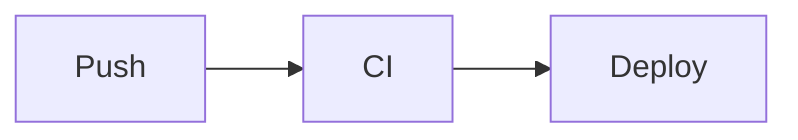

# vishine 使用文档 · USAGE

vishine 的完整使用与配置参考。视觉与交互规范见 [`DESIGN.md`](./DESIGN.md) / [`INTERACTION.md`](./INTERACTION.md) / [`MARKDOWN.md`](./MARKDOWN.md)。

> 三件「漏了就坏」的事，先记住：
> 1. `[outputs] home` 必须含 `JSON`，否则 ⌘K 搜索会显示索引不可用提示。
> 2. `[taxonomies]` 必须有 `tag` / `category`，否则板块色、筛选、统计都坏。
> 3. `[menu.main]` 不配则顶栏没有导航。

---

自动页面与写作组件统一入口见 [COMPONENTS.md](COMPONENTS.md)。新增栏目看 [SECTION-NAVIGATION.md](SECTION-NAVIGATION.md)，步骤／选项卡／折叠说明看 [RUNBOOK-COMPONENTS.md](RUNBOOK-COMPONENTS.md)。

## 1. 安装与升级

当前 CI 和本轮验证使用 **Hugo 0.163.3 extended**；theme.toml 声明最低 0.146.0，但未完整回归所有中间版本。

三种安装方式：

```bash
# A. Git submodule
git submodule add https://github.com/socake/vishine.git themes/vishine
git submodule update --remote   # 升级

# B. Hugo Module（hugo.toml 配 module.imports 后）
hugo mod get -u github.com/socake/vishine   # 升级

# C. 直接克隆
git clone https://github.com/socake/vishine.git themes/vishine
```

submodule / clone 方式在 `hugo.toml` 设 `theme = "vishine"`；Module 方式用 `module.imports`。

---

## 2. 配置参考（逐项）

### 2.1 站点基础

```toml
baseURL = "https://example.org/"
title   = "我的博客"
theme   = "vishine"
enableEmoji = true
enableRobotsTXT = true
summaryLength = 30        # 自动摘要词数（无 summary frontmatter 时）
```

### 2.2 语言

```toml
defaultContentLanguage = "zh-cn"   # 必需
[languages]
  [languages.zh-cn]
    label = "简体中文"
    locale = "zh-CN"
    weight = 1
```

`locale` 用于 `og:locale` 等 meta。

### 2.3 taxonomies（必需）

```toml
[taxonomies]
  tag = "tags"
  category = "categories"
```

分类法是板块色映射、列表筛选、首页统计的基础，**不能省**。

### 2.4 outputs（必需，含 JSON）

```toml
[outputs]
  home = ["HTML", "RSS", "JSON"]
```

`JSON` 生成 `/index.json`——⌘K 命令面板 fetch 它来搜索。**漏 JSON ⇒ 无可用索引 ⇒ 搜索显示错误提示**。这是最常见的踩坑。

### 2.5 menu（必需，支持二级下拉）

一级菜单直接给 `pageRef`；二级菜单用 `identifier` 定义父项（父项不需 pageRef），子项用 `parent` 挂上去：

```toml
[menu]
  [[menu.main]]
    name = "博客"
    pageRef = "/posts"
    weight = 10

  # 父项：只做下拉容器
  [[menu.main]]
    name = "运维"
    identifier = "ops"
    weight = 40
  # 子项：parent 指向父项 identifier
  [[menu.main]]
    name = "Kubernetes"
    parent = "ops"
    pageRef = "/docs/kubernetes"
    weight = 43
```

下拉项会自动显示其指向页面的子页数量。

### 2.6 markup（必需）

render hook（标题锚点、代码块、图片、链接）依赖以下设置：

```toml
[markup]
  [markup.goldmark.renderer]
    unsafe = false                # 主题不需要 raw HTML，保持 false 更安全
  [markup.goldmark.extensions]
    strikethrough = true
    table = true
    taskList = true
    [markup.goldmark.extensions.typographer]
      disable = true              # 关掉智能引号，避免中英标点被替换
  [markup.goldmark.parser]
    autoHeadingID = true          # TOC / 锚点必需
    [markup.goldmark.parser.attribute]
      title = true                # 支持 {.class} 属性
      block = true
  [markup.highlight]
    noClasses = false             # 必需：用 CSS class 高亮，才能随 scheme 翻色
    lineNos = false
    tabWidth = 2
    guessSyntax = true
  [markup.tableOfContents]
    startLevel = 2
    endLevel = 3
    ordered = false
```

`noClasses = false` 很关键：代码高亮走 CSS 变量，三套 scheme 才能正确换色。

### 2.7 pagination

```toml
[pagination]
  pagerSize = 8     # 列表页每页条数
```

---

## 3. Params 全表

| 参数 | 作用 | 默认 | 缺失影响 |
| --- | --- | --- | --- |
| `author` | 作者名（首页 kicker / meta author） | 空 | 首页 / meta 留白 |
| `authorEn` | 作者英文名 | 空 | 首页 kicker 少一段 |
| `role` | 头衔串，按 `·` 拆成首页 role chips | 空 | 不显示 chips |
| `tagline` | 首页大标题；按中文逗号 `，` 断行，末段高亮 | 空 | 首页大标题空 |
| `description` | 站点描述（首页 lead + 默认 meta description） | 空 | 留白 |
| `layeredSurfaces` | [固定背景与分层表面](DEPTH-SURFACES.md)，布尔值 | `true` | false 恢复原表面，整页滚动不变 |
| `defaultScheme` | 初始配色：`paper`/`clean`/`dark` | `paper` | 用 paper |
| `since` | 起始年份（统计面板 SINCE） | 空 | 留白 |
| `googleFonts` | 是否加载 Google Fonts CDN；`false` 改系统字体 | `true` | 默认走 CDN |
| `homeSections` | 首页板块顺序（section key 列表） | `["posts","playbook","docs","roadmap","resources"]` | 用默认顺序 |
| `featureZone` | 首页特色横幅（dict），见下 | 不配则不显示 | 不显示横幅 |

### featureZone 结构

```toml
[params.featureZone]
  title = "AI 专区"
  en = "AI ZONE"
  desc = "大模型 / 工具 / 应用 / AIOps 的工程化实践"
  count = "4 方向"
  [params.featureZone.lead]
    title = "AI 在帮我写脚本"
    desc = "把大模型真正接进 DevOps 工作流。"
  [[params.featureZone.cols]]
    k = "LLM"
    name = "大模型"
    desc = "推理、提示工程、模型选型与成本权衡。"
  # 可继续追加 [[params.featureZone.cols]]
```

---

## 4. 内容与板块

### 4.1 五大板块

| section 目录 | 板块 | class |
| --- | --- | --- |
| `content/posts/` | 博客 | `blog` |
| `content/playbook/` | 实战手册 | `play` |
| `content/roadmap/` | 路线图 | `road` |
| `content/docs/` | 运维文档 | `docs` |
| `content/resources/` | 资源 | `res` |

每个 section 建一个 `_index.md`（带 `title` / `description`）。`docs` 板块首页优先展示直属子栏目与其递归文章数；没有子栏目时回退为全站分类 chips。

### 4.2 板块色映射

颜色逻辑（见 `layouts/partials/cat-class.html`）：

1. 文章**首个分类** → 站点 `data/sections.toml` 的 `[categories]` 查表；
2. 未命中 → 文章所在 **section** 的板块 class；
3. 再兜底 → `blog`。

在**你自己站点**的 `data/sections.toml` 配映射（Hugo 深合并覆盖主题默认，主题默认为空）：

```toml
[categories]
  "Kubernetes" = "docs"
  "云原生"      = "play"
  "FinOps"     = "road"
  "大模型"      = "res"
  "故障复盘"    = "ai"
```

可选 class：`blog` / `play` / `road` / `docs` / `res` / `ai`。

> **精确匹配注意**：分类名要和 frontmatter 里写的完全一致，包括空格。`"AI工具"` 与 `"AI 工具"` 是两条不同的 key，常因此漏配导致颜色回退。

### 4.3 新增一个 section

1. 建 `content/<新section>/_index.md`；
2. 想让它进首页 bento / 用上板块色，需在主题或站点的 `data/sections.toml` 的 `[sections]` 增加对应项（`class` / `label` / `en`），并把 section key 加进 `homeSections`。否则该 section 仍可正常出列表页，只是回退到 `blog` 色、不进首页板块格。

---

## 5. Frontmatter 字段详解

| 字段 | 类型 | 说明 |
| --- | --- | --- |
| `title` | string | 标题，必填 |
| `date` | datetime | 发布时间，影响排序 / 统计 |
| `categories` | []string | 分类数组；**`index 0`（首个）决定板块色 + 自动封面配色** |
| `tags` | []string | 标签数组；卡片显示前 3 个 |
| `summary` | string | 摘要；卡片、搜索、meta description 用它。不写则取正文自动摘要 |
| `toc` | bool | 默认文章模板显示本页目录；false 可关闭，阅读宽度按钮仍保留 |
| `cover` | string | 手动封面 URL，优先级高于自动封面（低于 `featured.*` 资源） |
| `author` | string | 覆盖站点 `params.author` |

完整示例：

```yaml
---
title: "Nacos 一文通：配置中心与服务发现实战"
date: 2026-04-18T14:00:00+08:00
categories: ["中间件"]
tags: ["Nacos", "配置中心", "服务发现", "微服务"]
summary: "核心概念、架构原理、部署、SDK 接入、生产调优、故障排查与选型对比。"
toc: true
---
```

---

## 6. 写作元素

### 6.1 标准 Markdown

标题、列表、表格、引用、任务列表、删除线均按 `MARKDOWN.md` 的 prose 规范统一渲染（换页面不换渲染）。标题自动生成锚点，在配置的深度范围内进入 TOC。

### 6.2 Callout 提示框

```markdown

内容支持 **Markdown**。

```

`type`：`warn`（⚠️）/ `info`（💡，默认）/ `tip`（✅）。非法值回退 `info`。

### 6.3 Mermaid 图表

用围栏，主题自动渲染并随 scheme 换色，脚本 self-host（`static/js/mermaid.min.js`，不依赖外网 CDN）：

````markdown

````

### 6.4 图片 + zoom

把图放进 page bundle（文章目录里），Markdown 正常引用：

```markdown

```

render hook 自动包成 `<figure>`，可点击放大（lightbox）。正文直接使用原图，保留像素尺寸和格式，不再固定缩到 1280px 或转成有损 WebP；CSS 适配阅读宽度，图片按需懒加载。SVG 原样用。`alt` 作图注，`title` 作放大时的描述。

### 6.5 代码复制

每个代码块右上角自动带语言标签 + 复制按钮（main.js 接管，复制后有 ✓ 反馈）。无需任何标注。

### 6.6 TOC

默认文章模板在构建时从实际正文标题生成目录，包含 shortcode 输出的标题；脚本增强定位高亮与折叠。单篇 front matter 写 `toc: false` 可关闭目录，正文居中，阅读宽度按钮仍可用。

站点默认值可写在 `hugo.toml`：

```toml
[params.article]
toc = true
tocStart = 2
tocEnd = 4
```

未显式设置深度时沿用 `[markup.tableOfContents]`；显式设置要求整数 `1 <= tocStart <= tocEnd <= 6`，只填一端时另一端默认 2 / 3。单篇或栏目 cascade 的 `article` 映射可覆盖站点默认值。

需要跨文章连续阅读，在栏目的 `_index.md` 设置：

```yaml
cascade:
  params:
    readingNav:
      enabled: true
    sectionNav:
      order: weight
```

每篇文章设置显式 `weight`。右侧悬浮目录和手机目录抽屉提供“本页目录 / 浏览栏目”切换，分别定位本页标题和访问栏目文章；不会合并两棵导航树。切换状态在当前标签页内按根栏目记忆，方向键与 Home/End 切换，Tab 进入链接列表。关闭目录或没有有效标题时，栏目入口保留在面包屑旁。完整选项与无脚本回退见 [阅读契约](THEME-APIS.md)。

### 6.7 已有 HTML 图表

先按源文件选择：简单流程用 Mermaid，独立 `.svg` 用普通 Markdown 图片；已有包含 SVG／HTML 文字的 `.html` 图表，用 `html-embed` 保留矢量内容，不需要截图。

将可信、自行维护的图表放到宿主 `static/diagrams/flow.html`，正文写：

```markdown

```

`src` 是站点根目录下的本地 `.html` 路径（不含 `static/`），`title` 必填。`fit="width"` 让全图先适应正文宽度；配合非零 `minWidth`，窄屏可切换“放大细节 / 适应宽度”，细节视图只在图表内横向滚动。旧调用只写 minWidth 时仍保留原来的宽度下限。`height` 默认 480px；普通 `page` 模式不会自动调整高度或同步配色。

支持 Archify 嵌入约定的 HTML 可增加 `mode="archify"`，隐藏独立页外围工具栏，同步深浅配色并按内容调整高度；切换配色会重新加载图表。所有模式保留“打开完整图表”入口。此组件可以运行同源脚本，仅用于可信文件；HTML 内原本的位图不会因此变成矢量。参数范围、失败行为和限制见 [HTML-EMBED.md](HTML-EMBED.md)，可复制源码与效果见教程 14。

---

## 7. 封面

> **设计理念：能自定义，也能全自动。**
> 和它的前身 Blowfish 一样，vishine 的封面**完全可自定义**——你想放什么图就放什么（page bundle 里放 `featured.*`，或 frontmatter 用 `cover` 指定 URL），主题绝不抢你的图。
> 在此之上，vishine **额外提供了一套零配置的自动生成能力**：你不配图，主题也会按短主题标识和板块色，用 Hugo 原生能力自动渲染一张风格统一的封面。
> 即 **「想自定义就自定义，不想管就全自动」**，两者并存，你随时用自己的图覆盖自动封面，也可用 `params.cover.auto = false` 彻底关掉自动生成。

作者封面优先级（list / single / card 一致）：

1. **`featured.*` 资源**：page bundle 放 `featured.jpg`/`featured.png`/`featured.svg`，最优先（位图超尺寸自动缩 webp）。
2. **frontmatter `cover: "url"`**：手动指定。
3. **自动生成**：以上都没有时，桌面列表生成 SVG 缩略图，手机列表与正文默认使用宽幅主题图。文件由 Hugo 原生生成并缓存到 `/covers/`，无需第三方图片服务。完整标题由页面 HTML 呈现，图中使用短主题标识。

### 两种规格（variant）
- **hero**（正文和手机列表 1200×420）：短主题标识与几何图形；作为视觉缓冲，按原比例完整显示，不重复完整标题。
- **thumb**（列表缩略 800×500）：几何图形与短标识，优先取文章 `coverLabel`，其次首个 tag，再回退首个分类或 section。超过 18 字时缩为 17 字与省略号；它只是辅助图形，完整文章名始终显示在旁边。4 种版式按文章稳定选择（orbit / grid / diagonal / arc），手机保持原比例，不再裁成方图。

### 配置 `[params.cover]`
| 参数 | 默认 | 说明 |
|---|---|---|
| `auto` | `true` | `false` = 关闭自动封面，仍可用 featured 或 cover |
| `autoArticle` | `true` | 布尔值；false 单独关闭正文自动横幅。仅在 auto 不为 false、article.showCover=true 且没有作者封面时生效；不影响手机列表宽幅图 |
| `style` | `"auto"` | 桌面缩略图的 `auto`（轮换 4 版式）｜ `orbit` ｜ `grid` ｜ `diagonal` ｜ `arc`；宽幅主题图使用固定圆环构图 |
| `ignoreFeatured` | `false` | true 忽略 featured 老图，随后尝试 cover 字段与自动封面规则；文件仍保留，可随时关闭此选项 |

升级说明：自动正文横幅默认保留，但从重复的文章标题改为短主题标识；第一轮外观预览曾默认关闭，若仍需该效果，显式设置 `autoArticle=false`。`article.showCover=false` 仍关闭全部正文封面。`coverLabel` 是可选 front matter 字符串，不修改标题或分类，同时控制自动缩略图与宽幅图；不能嵌套。无自定义值时使用上述回退链。见教程 13 的源码与真实示例。

> **多路线下拉**：路线图 / 文档这类"一个 section 下多个子页"，把顶栏菜单项配成 `identifier`（父，无 `pageRef`）+ 多个 `parent = "<id>"` 的子项（见 `[menu.main]`），即得到和「运维 / AI」一样的顶栏下拉。每个子页是独立文章页（带 TOC 导航），避免长内容挤在一页。

### 着色与字号
- 板块色查 `data/sections.toml`（首个分类 → 板块 class → 色），无分类回退 section、兜底 `blog`。
- 短标识按**视觉宽度**计（中文≈1 / 英文≈0.62），字号随长度调整；超过 18 字显示 17 字与省略号。图内辅助分类最多 24 字，正文中的分类与标题均完整保留。

### 自定义 / 扩展
- **换配色**：改 `data/sections.toml` 的分类映射 + `cover-svg.html` 顶部 `$pal`/`$palD`/`$palB` 三组调色板。
- **加新版式**：在 `cover-svg.html` 的 thumb 分支加一段 `{{ else if eq $seed 4 }}…几何…{{ end }}`，并把版式选择的 `mod … 4` 改成 `5`。
- **改横幅风格**：改 hero 分支。

---

## 8. 三套 scheme

| scheme | 名称 | 适用 |
| --- | --- | --- |
| `paper` | 暖纸 | 默认，暖色 |
| `clean` | 纯白 | 浅中性灰页面衬底、纯白卡片与阅读面、清晰边界及中性阴影，无网格或暖色光晕 |
| `dark` | 暗色 | 暗环境 |

- **切换**：顶栏右侧三个色块按钮。
- **默认**：`params.defaultScheme`（默认 `paper`），写在 `<html data-scheme>`；已手动选择过配色的读者继续使用浏览器保存的选择。
- **持久化**：存 `localStorage` 的 `vishine-scheme`；渲染前由 `head-scheme.html` 内联脚本读取并应用，无白屏闪烁。阅读宽度同理存 `vishine-readwidth`（`comfortable`/`wide`）。
- **自定义 token**：三套 scheme 的颜色变量（`--c-blog`、`--ink-*`、`--code-*` 等）在 `assets/css/` 定义，按 `data-scheme` 切换。新增 / 改色规则见 `DESIGN.md`，务必三套各验一遍。

---

## 9. 自定义进阶

优先修改宿主配置，通用呈现能力在主题实现。宿主 `assets/css/custom.css` 当前不会自动加载；模板覆盖是需自行维护的例外。详见 [组件定制边界](COMPONENTS.md#定制边界)。

- **板块色**：改 `data/sections.toml`（映射）+ `assets/css` 的 `--c-*` token（实际色值）。
- **字体**：`googleFonts = false` 关 CDN，改用 `Noto Sans SC` / `JetBrains Mono` 的系统回退栈。也可自托管字体并通过 extensions/head.html 引用。
- **favicon**：替换 `static/favicon.svg`。
- **菜单**：见 §2.5，支持二级下拉。
- **首页板块顺序 / 特色横幅**：`homeSections` / `featureZone`（§3）。

---

## 10. 搜索（⌘K）

- 快捷键 `⌘K` / `Ctrl+K`，或点顶栏「搜索…」。
- 数据源 `/index.json`，由 home 的 JSON output 生成，每个纳入范围的 RegularPage 一项，包含标题、元数据和按小节分段的全文。命中片段可直达标题锚点；可用 params.search 控制范围和正文索引，见 [搜索契约](THEME-APIS.md#3-全文搜索)。
- **前提**：`[outputs] home` 含 `"JSON"`。漏掉则无法加载索引，面板显示错误提示；恢复 JSON 后重新构建。

---

## 11. 部署与排坑

- **GitHub Pages（Project Pages，子路径）**：`baseURL = "https://<user>.github.io/<repo>/"`。主题已用 `relURL` 处理 Mermaid 脚本路径（`window.VISHINE_MERMAID_SRC`），子路径下能正常加载；资源走 Hugo pipeline 也自动带前缀。
- **生产构建**：`hugo --minify`。生产模式下 CSS/JS 自动 concat + minify + fingerprint + 注入 SRI integrity。
- **Google Fonts 国内慢 / 被墙**：`params.googleFonts = false`，回退系统字体。
- **Mermaid 不显示**：确认 `static/js/mermaid.min.js` 存在、`baseURL` 子路径正确。

---

## 12. FAQ：页面空白 / 异常排查

| 现象 | 排查 |
| --- | --- |
| ⌘K 搜索打开但搜不到东西 | `[outputs] home` 漏了 `"JSON"`，访问 `/index.json` 看是否 404 |
| 顶栏没有导航 | 没配 `[menu.main]` |
| 卡片 / 标签颜色不对、都灰扑扑 | `data/sections.toml` 的 `[categories]` 分类名没**精确匹配**（空格、大小写），或没在站点侧配映射 |
| 代码高亮三套 scheme 不换色 | `[markup.highlight] noClasses` 不是 `false` |
| 标题没锚点 / TOC 空 | `[markup.goldmark.parser] autoHeadingID` 没开，或标题不在设定目录深度内、toc 被关闭 |
| 首页大标题 / 头衔 chips 空 | 没配 `params.tagline` / `params.role` |
| 构建报资源处理错误 | 用的不是 Hugo **extended** 版本 |
| 首页某板块缺失 | `homeSections` 里没列该 section，或 `data/sections.toml [sections]` 缺对应项 |

## 首页与品牌配置

### 首页板块与宽度

`params.homeSections` 默认是 `["posts", "playbook", "docs", "roadmap", "resources"]`。主题按实际显示的条目数选择标准卡或紧凑入口：普通板块统计文章，docs 子栏目索引统计子栏目，无子栏目时统计其分类入口；不超过一个条目（包括空栏目）使用紧凑入口。标准卡先排列，紧凑入口随后各占一行，两组内部都保留 homeSections 的相对顺序；featureZone 最后占满一行。窄屏全部单列，紧凑入口改为两行排列，不隐藏文章链接。

可选映射 `params.homeCardLayout` 按 section key 覆盖，允许 `auto`（默认或空值）、`standard`、`compact`；非法值导致构建失败，未列入 homeSections 的 key 不参与渲染。只影响呈现，不改变文章顺序、计数或 URL。宽度仍不依赖板块颜色：标准卡数量为 1 时占满、2 时各半、3 时各三分之一、4 时两行各半、5 时 `3+3 / 2+2+2`，6 及以上每行三块。

```toml
[params.homeCardLayout]
posts = "standard"
resources = "compact"
```

要保留旧版卡片组合，将已启用的所有 homeSections 项显式设置为 standard。紧凑行承载相同入口与真实内容，不增加虚构摘要来填空。教程 13 和示例站的资源入口展示实际效果。

`params.homeSectionsTitle` / `params.homeSectionsDescription` 可替换入口区标题与说明，默认沿用原 i18n 文案，避免两板块站点仍显示“五大板块”。每块提供 `sec-<key>` 类用于宿主微调，例如 `.sec-posts`。教程站只有一块 docs，示范单板块占满；两板块可写：

```toml
[params]
homeSections = ["docs", "posts"]
```

### 板块图标

在站点 `data/sections.toml` 的 `[sections.<key>]` 中写 `icon`。默认沿用 class 对应图标；内置名称为 `blog / play / docs / road / res / ai`，未知名称回退 blog。也可以提供完整 `<svg ...>...</svg>` 字符串（仅用于可信站点配置，主题原样渲染，并隐藏装饰图标的读屏输出）。

```toml
[sections.posts]
class = "ai"
icon = "ai"   # 也可写多行 SVG 字符串
```

两板块配置示例在 `exampleSite/presets/internal/`；默认 exampleSite 不加载此预设。

### 首页统计

`params.homeStats` 未配置时保留四格：posts 文章数、playbook 文章数、分类数、标签数。每项指定 `section`（顶层板块内全部已发布普通页面，含后代）或 `kind="categories" / "tags"`（全站 term 数）。`label` 可覆盖名称；省略时取栏目标题或翻译文案。数组顺序即显示顺序，第一格沿用强调色。

```toml
[params]
homeStats = [{section="posts", label="入门介绍"}, {section="docs", label="使用手册"}, {kind="categories"}, {kind="tags"}]
```

### docs 子栏目索引

首页 docs 卡片优先使用 `content/docs/` 的直属子栏目，按 weight 排序。数量是直属子栏目数；每行文章数包含该子栏目的后代文章。不会混入 posts 分类。不截断子栏目；没有子栏目时才回退原来的前 8 个全站分类。无需额外参数。

可运行的最小站点在 `exampleSite/presets/internal/`：7 个 docs 子栏目与 3 篇 posts，无模板覆盖。主题根目录运行：

```sh
hugo --source exampleSite/presets/internal --themesDir ../../../.. --minify
```

`--themesDir` 相对 source 指向主题仓库的父目录。建议把 `--destination` / `--cacheDir` 指向仓库外；或复制此预设为自己的宿主站。

### 最近更新范围

`params.recentSections` 默认 `["posts"]`；合并配置的顶层板块全部已发布文章，再按 date 倒序排列。`params.recentLimit` 默认 6，须为正整数；非正数回退 6。文章只出现一次。

```toml
[params]
recentSections = ["docs", "posts"]
recentLimit = 6
```

### Hero 链接与身份文字

`params.heroLinks` 默认未配置，回退为 role 纯文字（按 `·` 分隔）。配置后显示真实链接：首个实心主色，其余描边，带箭头、悬停反馈与键盘焦点。每项需要 name 与 pageRef 或 url；同时提供时 pageRef 优先。pageRef 通过 Hugo 页面解析，自动支持部署子路径与当前语言；无法解析或缺少 name 的项跳过。url 可为外链或站内路径。

```toml
[params]
heroLinks = [{name="使用手册", pageRef="/docs"}, {name="入门介绍", pageRef="/posts"}]
```

### 品牌名

`params.brand = {pre="Dev", hl="Box"}` 同时作用于页头、缩略封面与详情封面，hl 使用强调色。pre / hl 可单独配置。显式配置品牌时，详情封面的品牌标记放在横幅裁切范围内。未配置或两项都为空时，回退 site.Title；Title 也为空时回退 vishine。回退名称恰为 vishine 时保留原来的 vi / shine 分色，现有博客无需改配置。

```toml
[params]
brand = {pre="Dev", hl="Box"}
```

### 标签与分类链接

标签使用 Hugo 的 term 页面链接（`.GetTerms "tags"`），不手工 urlize 拼 URL；支持 `bcecmd -c` 这样的空格与连字符组合以及自定义 taxonomy permalink。首页、页脚和列表 taxonomy 链接也使用 term 页面。内部教程示例第一篇文章含此标签，可点击验证。无需新增参数。

### 自动封面断行

详情封面标题超过 11 字时优先在最接近中点的空格断行；纯中文保留原来的中点分行。无空格的混排会寻找 ASCII 单词外的断点；单个完整 ASCII 单词保持一行。字号按两行较长者计算。无需参数；内部教程示例标题「sslaunch 是什么」展示空格断行。

### 子栏目行与 taxonomy 胶囊

docs 子栏目自动使用两列索引行：圆点、标题、右侧文章数与底部分隔线；520px 以下单列。悬停仅改变标题 / 圆点并显示箭头，不填背景；键盘聚焦显示 outline。分类 / 标签继续使用胶囊样式。内部教程预设的七个子栏目演示此区别，无需额外配置。

### 追加站点 CSS

`params.customCSS` 默认 `[]`。路径相对站点 assets（不写 assets/ 前缀）；按数组顺序追加到主题全部 CSS 后，共用 Concat / Minify / Fingerprint 管线。文件不存在时静默跳过；无需覆盖 head.html。不从 static 加载。

```toml
[params]
customCSS = ["css/site.css"]   # 对应 assets/css/site.css
```

内部教程预设同时配置了存在和不存在的文件，演示可选扩展与静默回退。

### 无脚本、打印与减少动效

入场动画是渐进增强：默认 HTML 内容可见，仅 main.js 成功初始化 IntersectionObserver 后在 html 加 js 类，启用 reveal 动画。JS 禁用 / 未加载、浏览器不支持 observer、打印以及 `prefers-reduced-motion: reduce` 下保持可见。无配置开关；可在示例站关闭 JS 或打印预览验证最近更新与所有板块。

### 页脚简介

`params.footerTagline` 默认未配置，保留原来的「作者 + 的技术索引 + description」组合。配置字符串时用它替换整个简介；空字符串只显示站点标题，可用于非博客站点。

```toml
[params]
footerTagline = "团队共享的工具使用手册。"
```

### 默认配色与读者选择

`params.defaultScheme` 默认 `"paper"`，可选 `paper / clean / dark`。切换器固定顺序是暖纸、纯白、暗色，不表示每个站点的默认项；`aria-pressed` 表示当前选择。首次访问使用 defaultScheme，读者在浏览器保存的配色选择优先。更改站点默认色不会强制重置读者偏好；验收新默认色时清除该站点的 `vishine-scheme` localStorage 或使用新浏览器配置。

```toml
[params]
defaultScheme = "paper"
```

### 参数默认值速查

| 参数 | 默认值 |
| --- | --- |
| homeSections | posts / playbook / docs / roadmap / resources |
| homeSectionsTitle / homeSectionsDescription | 原 i18n 的板块标题与说明 |
| homeStats | posts 数 / playbook 数 / 全站分类数 / 全站标签数 |
| recentSections / recentLimit | `["posts"]` / `6` |
| heroLinks | 无；回退 role 文字 |
| brand | site.Title，最后 vishine |
| customCSS | `[]` |
| footerTagline | 原作者、技术索引与 description 文案 |
| defaultScheme | `paper`；已保存的读者选择优先 |
| sections.<key>.icon（data） | class 对应内置图标，未知名称回退 blog |

板块宽度、docs 索引、term 链接、封面断行与无脚本可见性由主题自动处理。升级后，宿主可把等效首页 / 页头 / 自动封面 / head 覆盖迁移为以上配置；删除前先核对自己的覆盖是否还包含其他专属功能。

回归检查：`python3 scripts/check-home-config.py --hugo /path/to/hugo`。它构建两板块预设并覆盖卡片数量、子栏目计数、统计、品牌、链接、标签 permalink、断行、CSS 扩展与原默认配置。

## 阅读与扩展参数

任意栏目连续阅读、article 布局开关、目录深度、全文搜索、全部筛选、图片查看、customJS / 扩展 partial、运行时 i18n 和 PWA 缓存策略见 [THEME-APIS.md](THEME-APIS.md)。教程 14 提供可复制源码与实际效果；教程 12 的示例分支演示普通目录中的章节导航。
