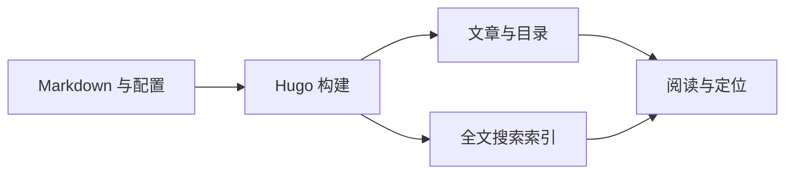

这一页已经启用 `article.tocEnd: 4` 和 `article.showCover: false`。右侧目录会包含第四级标题，顶部直接进入正文。完整默认值、限制与升级行为见仓库的 `docs/THEME-APIS.md`。

## 文章布局

单篇 front matter 可覆盖站点 `[params.article]` 默认值：

```yaml
article:
  tocEnd: 4
  showCover: false
  showRelated: false
```

### 再细一级

标题深度按文章需要配置，不必把所有小节都改成 H2。

#### 第四级标题的真实效果

点目录中的这一项可以直达这里。关闭目录用 `toc: false`；阅读宽度按钮仍保留，见[实际短说明页]()。

## 任意栏目中的章节

在栏目的 `_index.md` 设置：

```yaml
cascade:
  params:
    readingNav:
      enabled: true
    sectionNav:
      order: weight
```

每篇文章设置 weight 即可。本站[示例分支中的普通文章]() 和短说明页实际启用了这段配置，可以从上一章/下一章往返。在普通文章的右侧悬浮目录中切换“本页目录 / 浏览栏目”，滚动正文后仍能切换同级文章；手机点击悬浮“目录”按钮后也能切换。左右方向键可切换选项，Tab 进入链接列表。没有 track，也不在 roadmap 目录中。

## 全文与小节搜索

打开搜索面板，输入 **VISHINE_BODY_014**。这个独有词只放在正文里，应能找到本页并跳到本节，结果附带附近文本。搜索范围可选“教程”，按 Esc 可退出。

```toml
[outputs]
home = ["HTML", "RSS", "JSON"]

[params.search]
includeBody = true
# sections = ["docs", "posts"]
# excludeSections = ["archive"]
```

文章可用 `search: false` 从站内索引排除；这不会把文章变成私密内容。大站可限定 sections 或关闭正文索引，以控制下载体积。

## 图片与图表查看

点击下面图表，使用适合窗口、放大/缩小和方向键查看，Esc 关闭。普通 Markdown 图片还有原始大小与原图链接；正文直接使用原图，不再生成 1280px 的有损预览；图片临近视口时懒加载，打开查看器复用该原图。密集图缩小后字号也会变小，可用宽屏阅读或查看器阅读细节。



## 直接嵌入 HTML 图表

已经有 HTML / SVG 图表时，直接嵌入该文件，避免截图后再缩放。将文件放到宿主的 `static/diagrams/`，正文写：

```markdown

```



上方展示的正是这段源码。窄屏时图表区域可以左右滚动，Tab 聚焦该区域后也能用方向键滚动；整篇文章保持自然上下滚动。“打开完整图表”在独立页面浏览原文件。

`src` 和 `title` 必填；`height` 默认 480px，`minWidth` 默认 0（随容器宽度）。复杂图可按原始设计宽度设置 minWidth，避免把字缩得过小。Archify 生成的 HTML 可额外写 `mode="archify"`，使用它自带的嵌入模式，并跟随博客的浅色 / 暗色；切换配色会重新载入图表。完整限制见 `docs/HTML-EMBED.md`。

## 列表中的全部筛选

普通博客列表默认只露出三个常用分类，“全部筛选”包含其余分类和标签并支持搜索。要减少首屏按钮可以设置：

```toml
[params.listFilters]
quickCount = 2
```

这个设置不影响本教程使用的栏目总览；完整筛选效果可在成品示例站的博客页操作。

## 少量站点扩展

```toml
[params]
customCSS = ["css/site.css"]
customJS = ["js/site.js"]
```

把文件放在宿主 assets/。CSS 在主题样式之后；JS 在主题脚本之后，按顺序 defer 加载。缺失 JS 会给出构建警告。

需要添加独有的文章末尾说明，可以新建宿主 `layouts/partials/extensions/article-after.html`：

```go-html-template
<aside aria-label="文章说明">
  <p>本文属于 {{ .Site.Title }}。</p>
</aside>
```

另有 head、article-before、footer 三个同级扩展点，均接收当前 Page。它们适合站点专属集成；通用呈现仍应维护在主题里。

## 发布前检查

在主题仓库运行：

```sh
sh scripts/check-theme.sh
```

它检查示例、教程、独立宿主和状态逻辑。CI 在最低支持版本 0.146.0 与当前使用版本 0.163.3 extended 上运行。界面改动还要用浏览器检查窄屏、配色、键盘、刷新/返回；构建成功不能替代这些检查。
